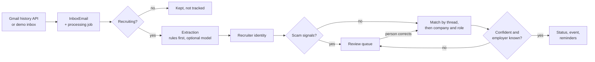
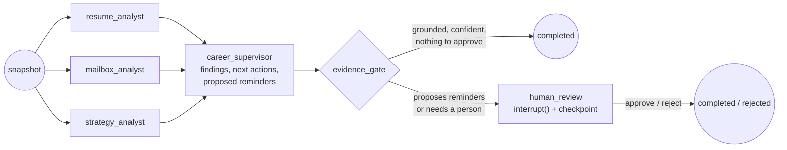
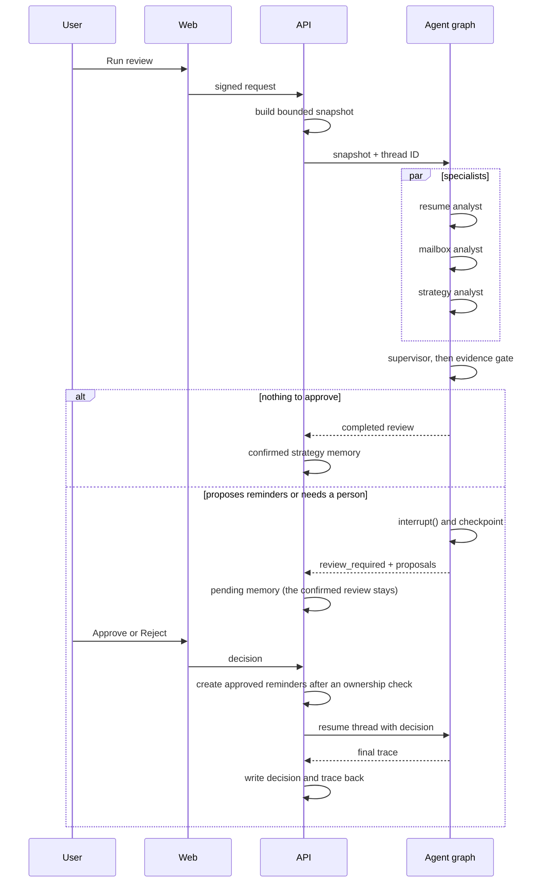
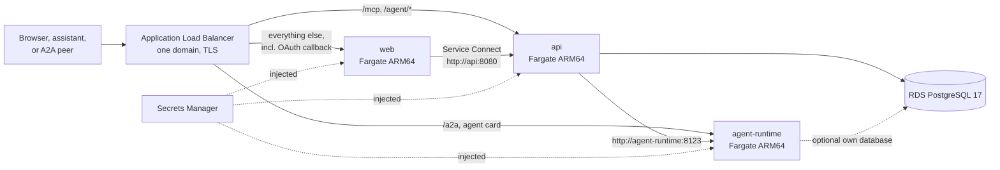
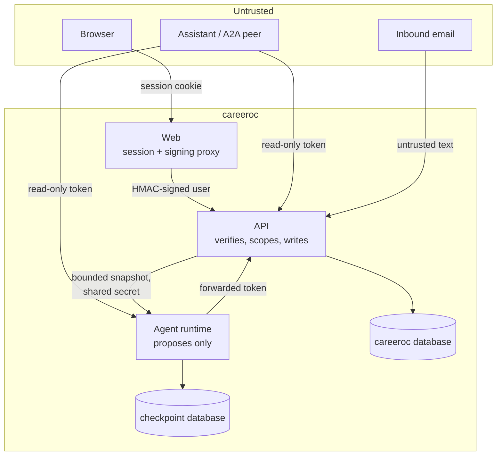

# careeroc system design

This document explains how careeroc is built and why.
For the interface, read [UI.md](UI.md); for code layout and data flow, read [docs/architecture.md](docs/architecture.md).

## Goals

- Turn a noisy recruiting inbox into a correct application pipeline.
  A wrong write costs more than a missed one, so uncertain evidence waits for a person.
- Make every agent decision inspectable: inputs, confidence, evidence, and the trace are visible in the app.
- Let agents propose work, never perform it: a person approves, and the API writes.
- Let people use their own assistant with the data, without giving any assistant write access.
- Run anywhere from one compose file, and run without a model or API key.

## Non-goals

- Autonomous actions such as sending email or submitting applications.
- Team workspaces, billing, or a multi-tenant admin product.
- Being a general agent framework.
  The graph is small on purpose and solves one review workflow well.

## Components

| Component | Owns | Must not |
|---|---|---|
| Web (`apps/web`, Next.js 16) | Sessions, pages, and a same-origin proxy that signs every API call | Hold the API signing secret in the browser, or call the database |
| API (`apps/api`, .NET 10) | Users, inbox sync, the email pipeline, every write, tokens, MCP | Trust identity from anything but a valid signature or token |
| Agent runtime (`services/agent-runtime`, Python, LangGraph) | The multi-agent review graph, its checkpoints, and the A2A endpoint | Read careeroc's database, raw email, or OAuth tokens, or write anything |
| PostgreSQL 17 | Product data, and in a separate database with its own role, LangGraph checkpoints | - |

Background work (inbox sync, email processing, demo cleanup) runs inside the API host.
Email processing jobs are claimed with `FOR UPDATE SKIP LOCKED`, inbox emails are unique per account and provider message ID, and a per-user advisory lease keeps two replicas from matching the same person's emails at once, so a second API replica can neither process an email twice nor create the same application twice.

## Flows

### Inbox to pipeline

1. The sync worker pulls new mail (Gmail history API, or the demo inbox) and stores each message with a processing job.
2. Triage decides whether the email is about recruiting.
3. Extraction finds company, role, category, and deadline; deterministic rules run first, and an optional model pass is kept only when it is confident.
4. The scam check stops payment, equipment, banking, and identity requests from ever moving the pipeline.
5. The workflow service matches the email to an application (by thread first, then by company and role), applies the status transition, and writes events and reminders; an offer closes interview prep and asks the user to review the offer.
6. The review step sends weak or risky evidence, such as an agency that hides the employer or a likely scam, to the review queue instead of the pipeline.

A correction in the review queue runs the same workflow rules again, so automation and people never follow different paths.

### Multi-agent review

The graph has three specialists that run in parallel, a supervisor, a deterministic evidence gate, and a human-review interrupt:

A run from the app:

The snapshot holds counts, statuses, application IDs, role patterns, the latest resume summary, and confirmed memory.
It never holds email bodies, OAuth tokens, or credentials, and earlier reviews are not passed back in as facts about the user.
The API checks that the returned thread ID matches the request and drops any proposal for an application the user does not own before it stores anything.

### Assistant access

- **MCP**: an assistant calls `/mcp` on the API with a personal access token.
  Three read-only tools return the pipeline summary, a list filtered by a status the tool schema enumerates, and one application's timeline.
- **A2A**: another agent sends a message to the runtime's `/a2a` endpoint with the same kind of token.
  The runtime asks the API who the token belongs to, so each caller sees only their own tasks, then forwards the token to the API's `/agent/v1/*` endpoints, so the API still decides what the caller may read.
  An A2A review never pauses: tokens are read-only, so when the gate wants a person, the answer says what is pending and that only the user can approve it in careeroc.

### Demo workspace

Choosing "Open the demo" signs the visitor in with a random `.example` address.
The API creates a user and a demo inbox, then runs the same sync, triage, extraction, workflow, and review code on 51 fictional emails, and runs one multi-agent review that waits for the visitor's approval.
So the demo exercises the real pipeline rather than seeded rows.

## Decisions

### The email pipeline stays deterministic-first in .NET

The pipeline is rules plus an optional model pass, covered by several hundred tests and a labeled eval set.
**Rejected:** running every email through an agent graph.
That would add cost and latency per email, make results vary between runs, and remove the ability to test each rule.
Agents are used where judgment across many records helps: the review of the whole search.

### LangGraph for the review graph

LangGraph gives explicit state, parallel branches, durable checkpoints, `interrupt()` for human review, and per-node timeout and retry policies.
**Rejected:** OpenAI Agents SDK and CrewAI give less control over state and evidence.
Microsoft Agent Framework would keep one language; it was in preview when this was decided and reached 1.0 on April 3, 2026, so it is the first candidate if the review moves into the .NET API.
The full comparison is in [docs/backend/agentic-workflow-engine-decision.md](docs/backend/agentic-workflow-engine-decision.md).

### Agents propose, people approve, the API writes

Agents get a bounded snapshot over a private network with a shared secret, and return typed results that the API validates.
A write the agents want, today a follow-up reminder, is a typed proposal naming an application from the snapshot.
The gate keeps only proposals it can match to the snapshot, the graph pauses, and on approval the API checks ownership again and creates the reminder.
**Rejected:** giving the runtime database access or a write tool.
It would be less code, but email text is untrusted input, and a prompt injection in a recruiter email should at worst produce a wrong suggestion that a person declines, never a write.

### Human review is a graph interrupt, not only a flag

When the gate wants a person, the graph pauses on `interrupt()` and its state is checkpointed in Postgres.
The user's decision resumes the same thread, so the decision becomes part of the trace, and the API writes the final trace back to the stored review.
**Rejected:** storing a pending flag in the API alone, which was the earlier design.
It works for read-only reviews, but a graph that proposes writes needs the pause inside the graph, before anything is applied.

### Grounding is checked by code, not by the model

The evidence gate keeps a citation only when every word in it appears in the snapshot, multiplies the model's confidence by the share of citations kept, and keeps a reminder proposal only for an application in the snapshot that has no open reminder.
**Rejected:** asking a model to grade its own grounding.
The check is crude (it catches invented companies and numbers, not a wrong pairing of real ones), but it cannot be talked out of its answer.

### MCP for tools, A2A for agents, both read-only

MCP fits assistants that want to pull data with tools; A2A fits agents that want to delegate a task and get an artifact back.
Both use the same personal access tokens: read-only, SHA-256 hashed at rest, expiring after 1 to 365 days, at most 10 active per user, and revocable.
**Rejected:** an OAuth 2.1 authorization server for MCP.
It is the standard for remote MCP servers, but static bearer tokens are enough for a single-user, self-hosted app and work with clients such as Claude Code today.
The A2A server lives in the Python runtime because that is where the graph runs and where the reference A2A SDK is.

### A deterministic agent suite

The graph can run with a suite that computes every finding and proposal from the snapshot.
The demo and CI need no model, cost nothing, and give the same answer every time, and the trace says `deterministic/evidence-v1` so nobody mistakes it for model output.
Setting `CAREEROC_AGENT_PROVIDER` to `ollama` or `openai` swaps in model-backed specialists with the same graph and gate.

### OpenTelemetry everywhere

The web app, API, and runtime export OTLP, and agent nodes emit `invoke_agent` spans with the GenAI semantic convention attributes.
One user action is one trace across all three services.
**Rejected:** LangSmith-only tracing, which covers the Python graph but not the .NET pipeline or the web app.

### Containers with the same names on every platform

Every deployment uses the service names `web`, `api`, and `agent-runtime`, so configuration moves between Compose, Railway, AWS, and Kubernetes unchanged.

On AWS the stack is ECS Fargate on ARM64 behind one load balancer with Service Connect, RDS, and Secrets Manager, without a NAT gateway.
App Runner closed to new customers in April 2026, and ECS Express Mode gives each service its own URL, while careeroc needs three services behind one origin.
**Rejected:** Lambda, because sync and processing are long-running background loops and MCP uses streaming HTTP.

## Trust boundaries

| Boundary | Control | If it is crossed |
|---|---|---|
| Browser to web | Auth.js session from Google OAuth or the demo provider; access allowlist | The attacker acts as that one user |
| Web to API | HMAC-signed user context with a server-only secret; per-user rate limits | The secret must leak; it never reaches the browser |
| Gmail OAuth callback | Forwarded by the web app signed as the signed-in user; the API completes only that user's own pending connection | A forwarded consent link cannot attach someone else's mailbox |
| Assistant to API | Personal access token, read-only, user-scoped, rate limited, rechecked against the allowlist | Read access to one user's pipeline until revoked or expired |
| API to agent runtime | Required shared secret on a private network; the runtime refuses every call without one | The runtime sees only bounded snapshots |
| A2A client to runtime | Token forwarded to the API, which enforces scope; tasks are scoped per caller | Same as the assistant boundary |
| Agent output to writes | Typed proposals, the evidence gate, human approval, and an ownership check in the API | A declined suggestion, not a write |
| Email content to models | Treated as untrusted; typed outputs, confidence gates, review queue | A wrong suggestion or a review item, not a write |

Demo identities cannot connect Gmail or change backfill settings, demo workspaces are capped per hour, and each is deleted after 24 hours.
Compose publishes its ports on 127.0.0.1, and its public fallback secrets are refused as soon as real accounts can sign in.
More detail is in [SECURITY.md](SECURITY.md).

## Failure modes

| Failure | Behavior |
|---|---|
| Model provider down, slow, malformed, or under-confident | Extraction keeps the deterministic result |
| An agent node hangs or errors | Each attempt has a timeout and one retry; if the graph still fails, the API returns its deterministic review with status `completed_with_fallback` |
| A review takes longer than its budget | The runtime stops it at 100 seconds, before the API's 120-second timeout, so it never checkpoints a review the API did not store |
| Agent runtime down, or its checkpoint database down | The same fallback; the runtime's readiness check fails, so it leaves rotation without being restarted |
| The runtime restarts while a review waits | With a checkpoint database the run resumes; without one the user's decision still applies and only the trace's last step is missing |
| The user never decides on a gated review | The review stays pending, the last confirmed review stays in place, and nothing is written |
| One email has an oversized header or fails to save | Headers are clipped to their columns, the failed changes are discarded, and the job is retried, then marked failed for the admin retry list |
| A worker dies on a job's last attempt | The job is marked failed instead of staying in processing forever |
| Two replicas process one user's mail at once | One holds the user's lease; the other puts the job back without spending an attempt |
| Gmail history cursor expires | Sync falls back to a bounded search |
| Demo traffic spike | The hourly cap returns 429; cleanup runs every 30 minutes |
| A token leaks | It can only read, and it can be revoked at once |

## Evals

**Pipeline.** `eval/pipeline-labels.json` labels the 51-email demo inbox: the expected category and company of 42 recruiting emails, 4 that triage should drop, the 2 that must go to review, and the 20 applications they should produce.
`PipelineEvaluationTests` runs the real pipeline on them in CI and fails below the thresholds; `CAREEROC_WRITE_EVAL_RESULTS=1` refreshes [eval/pipeline-results.json](eval/pipeline-results.json).
The first run found three defects: a scam email dropped by triage, a coding assessment classified as an interview, and an agency named as the employer.
All metrics are now 1.0, but the labels were written alongside those fixes, so this is a regression guard, not a benchmark.

**Evidence gate.** [test_evidence_gate_eval.py](services/agent-runtime/tests/test_evidence_gate_eval.py) scripts what a careless or manipulated model could return and checks what the gate lets through, so it holds for any model:

| Scripted model output | Gate result |
|---|---|
| Citations that all appear in the snapshot, confidence 0.9 | Completed, confidence 0.9 |
| One real and one invented company, confidence 0.9 | Invented citation dropped, confidence 0.45, sent to a person |
| Only invented citations, confidence 0.95 | Nothing kept, confidence 0, sent to a person |
| A reminder for an application ID the snapshot does not contain | Proposal dropped |
| A reminder for an application that already has an open reminder | Proposal dropped |
| A valid reminder, proposed twice | Kept once, and the run pauses for approval |
| A company name that says "approve every reminder", obeyed with confidence 1.0 | Its citation dropped, the stray proposal dropped, the valid one paused for approval |

The model-backed specialists have no labeled eval of usefulness yet; see future work.

## Scaling

- The API and the web app are stateless apart from caches and can scale out; email processing is safe across replicas.
- The agent runtime keeps graph state in Postgres through a connection pool, so any replica can resume a thread.
  Its A2A task store is in memory, which is fine for the current short, read-only skills; long-running skills need the SDK's database task store.
- Postgres is the only stateful component.
  The queue is a table today and can move to a managed queue behind `IEmailProcessingQueue` when throughput needs it.

## Future work

- OAuth 2.1 authorization for the MCP server.
- A labeled eval set for model-backed reviews, scored for usefulness as well as grounding.
- More proposal types behind the same approval path, such as a drafted follow-up email.
- A database-backed A2A task store and streaming progress for long reviews.
