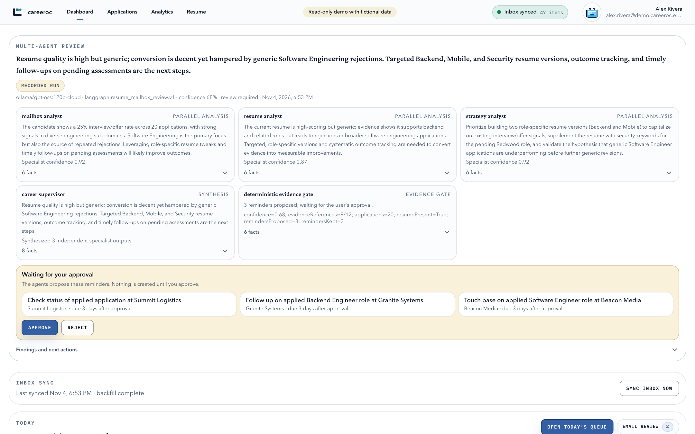
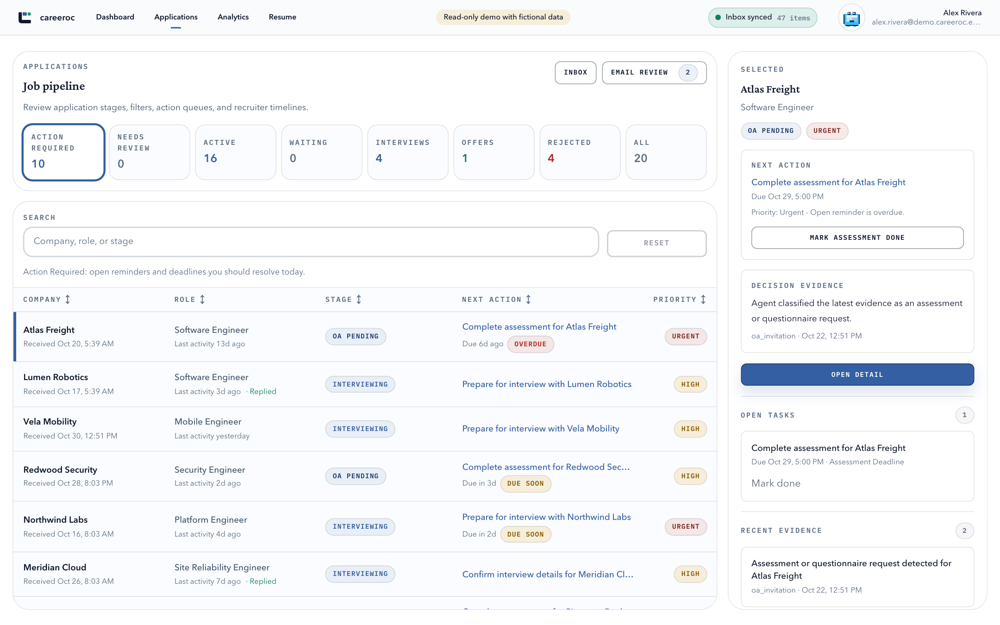
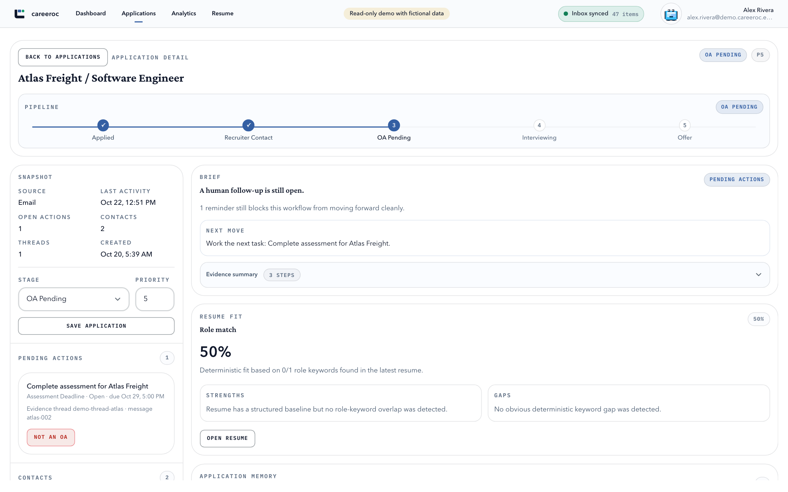
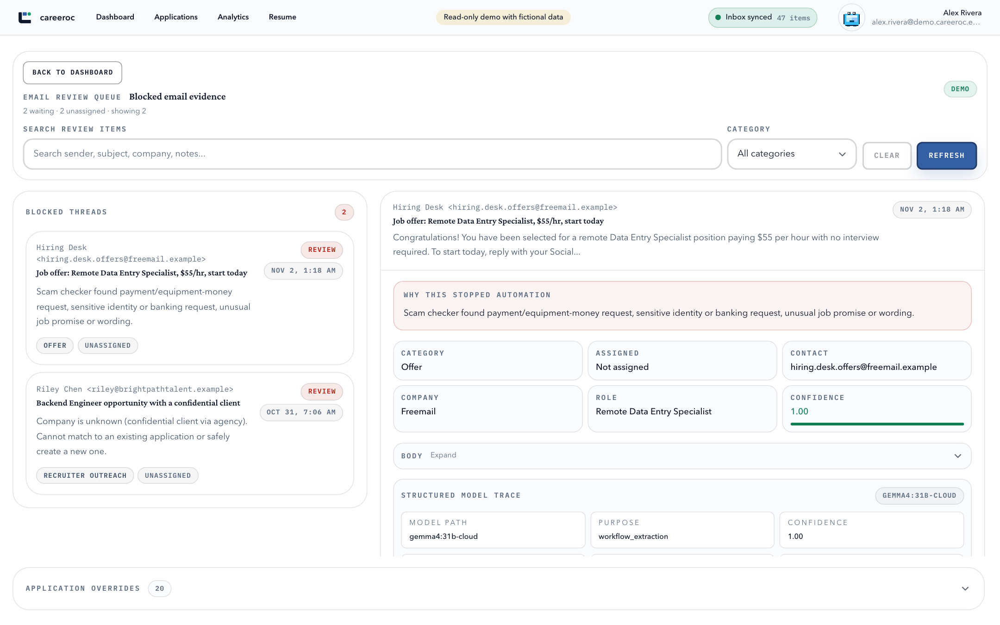
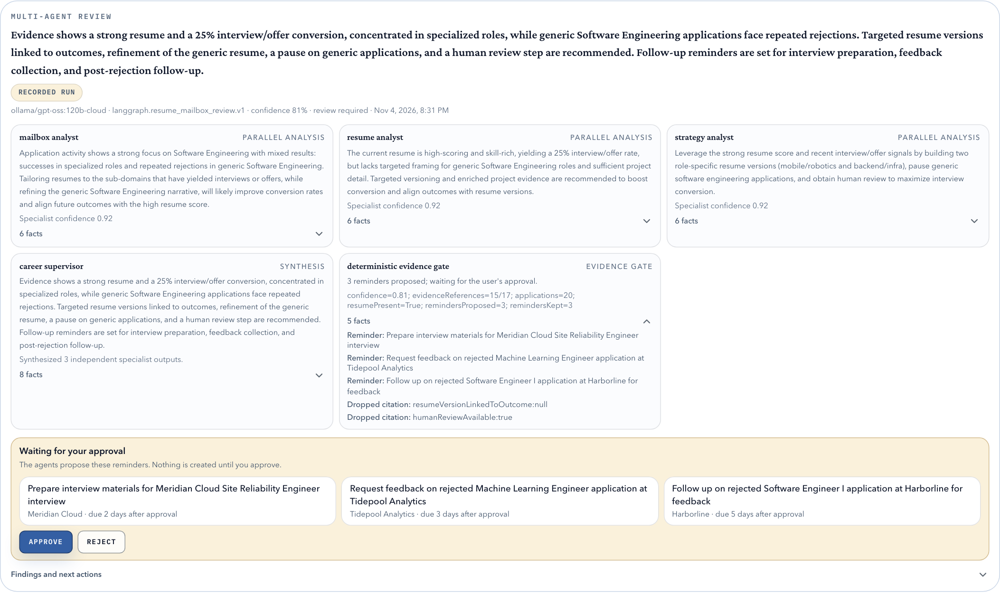
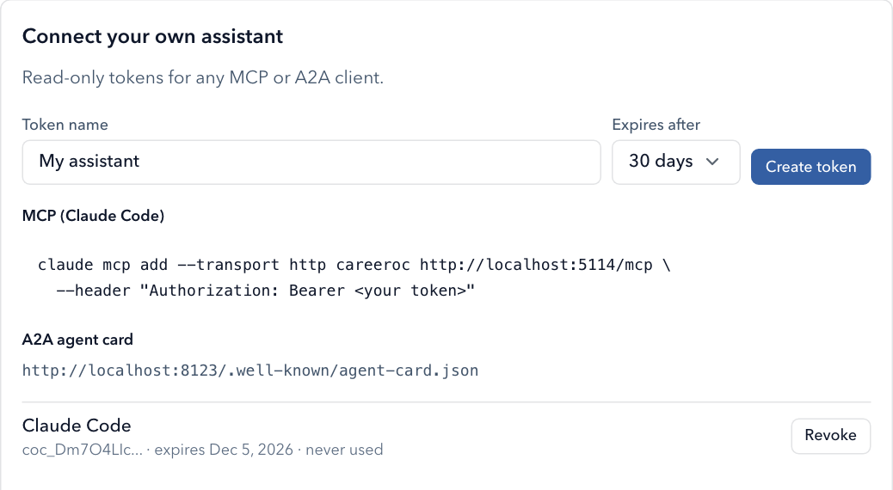
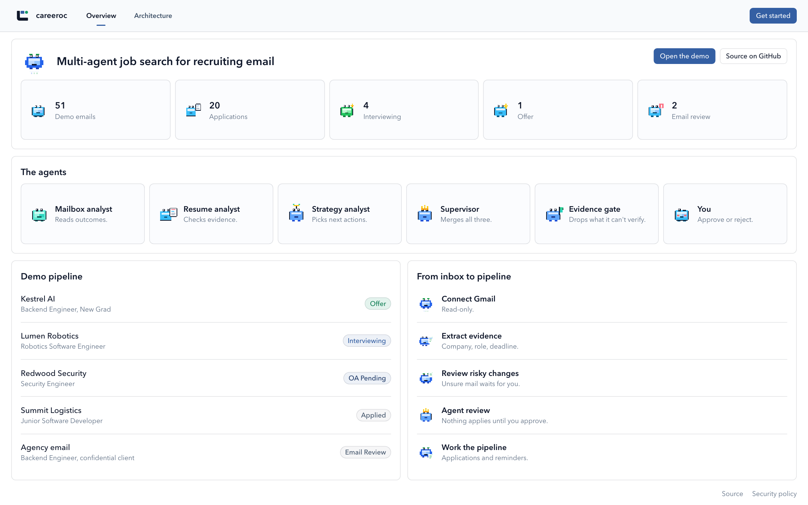
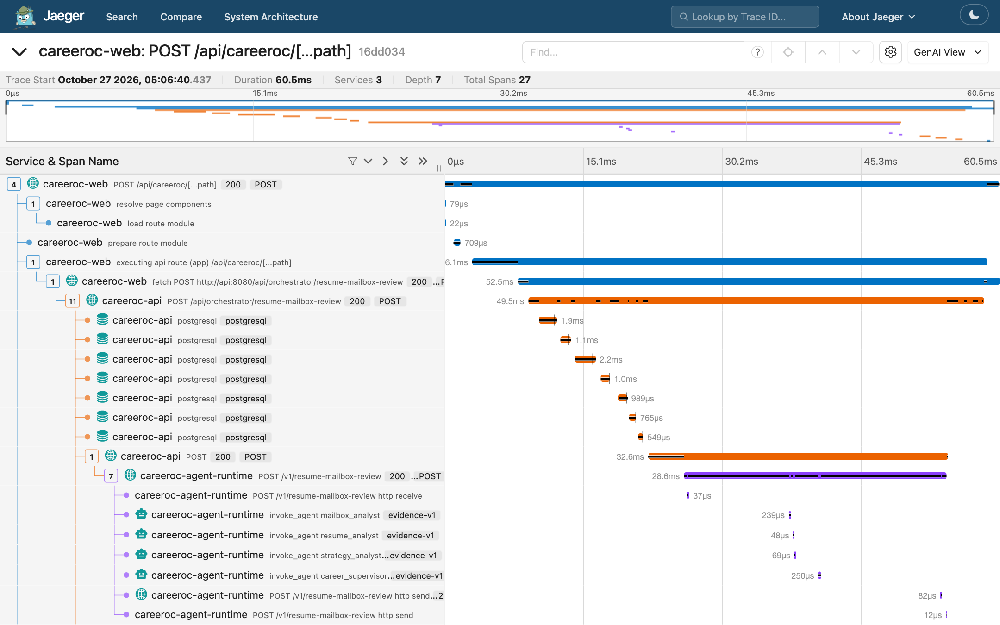
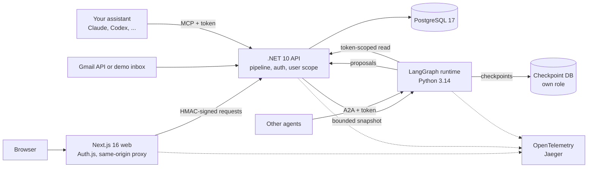

# careeroc

> The current careeroc is a job search skill for your agent: [hskl18/careeroc-skill](https://github.com/hskl18/careeroc-skill), with its site at [careeroc.com](https://www.careeroc.com).
> This repository is the earlier hosted product, kept as a reference implementation.

An open-source, multi-agent job search workspace.
careeroc reads recruiting email and keeps an evidence-backed pipeline of applications, deadlines, and next actions.
Specialist agents review the search, a person approves what they propose, and your own assistant can read the pipeline over MCP or A2A.

**Live demo: [careeroc.vercel.app](https://careeroc.vercel.app).** It needs no sign-up and opens a read-only workspace recorded from the real pipeline on a fictional inbox, with free Ollama models behind it: `gemma4:31b` on each email and `gpt-oss:120b` for the multi-agent review.
The recording is kept as it came out, and approving the review on the dashboard replays the end of the graph in your browser.

Run the whole system with one command, no accounts or API keys: `docker compose --profile full up -d`, then open http://localhost:3000.
There, **Open the demo** gives each visitor a private workspace, run through the real pipeline and removed from the product database after 24 hours, including the multi-agent review, approvals, MCP, and A2A that the hosted demo cannot offer.



careeroc ran as a hosted product with a small beta, and I gave up on it.
It is a good fit for my own job search and a poor fit for a product, mainly because agents can now do this work themselves.
This repository is its complete source, published as a reference implementation.
It is a working system rather than a template: a .NET 10 API, a Next.js 16 web app, and a Python LangGraph runtime, with tests, evals, traces, and deployment code for Compose and Kubernetes.

## What it shows

| Area | What is in the code |
|---|---|
| Email to pipeline | Deterministic-first extraction in .NET: triage, company, role, stage, deadlines, thread continuity, and reminders. An optional model pass is used only when it is available and confident; otherwise the deterministic result stands. |
| Review gates | Uncertain or risky evidence (agencies, scams, weak company matches) pauses in a review queue instead of changing the pipeline. |
| Multi-agent review | A LangGraph graph runs resume, mailbox, and strategy specialists in parallel, a supervisor merges them and proposes follow-up reminders, and an evidence gate checks every citation and proposal against the user's own data. |
| Human in the loop | A review that proposes a write pauses on a LangGraph `interrupt()` with a Postgres checkpoint. When the user approves it, the API, never the agents, creates the reminders, and the graph resumes so the decision lands in its trace. |
| Bring your own assistant | Read-only personal access tokens, an MCP server at `/mcp`, and an A2A 1.0 agent with a public agent card. |
| Observability | OpenTelemetry from the browser-facing web app through the API into each agent node, using the GenAI `invoke_agent` span conventions. |
| Evals | The 48 inbound emails of the 51-email demo inbox, labeled by hand and scored in CI with the rules alone for triage, category, company, status, and review precision and recall; the same scores for each free Ollama model, run by hand with `scripts/eval-model.sh`; and a model-free eval of the evidence gate against invented citations and prompt injection. |
| Deploy | Docker Compose and a Helm chart for any Kubernetes, both started and smoke tested in CI, and multi-arch images on GHCR. |

## Screenshots

| | |
|---|---|
|  **Applications.** 51 emails become 20 tracked applications. |  **Application detail.** Pipeline stage, evidence, the next move, and resume fit. |
|  **Review queue.** The agency and the scam email wait for a person. |  **Multi-agent review.** The agents propose reminders, the gate drops the citations it cannot find, and nothing is created until the user approves. |
|  **Connect your own assistant.** Tokens, the MCP command, and the A2A card. |  **Landing.** One click opens the demo. |

One "Run review" click, traced across all three services in Jaeger:



## Architecture



- **The API owns every write.** Agents receive a bounded snapshot with no email bodies, OAuth tokens, or database credentials, and return typed results and proposals; the API applies a proposal only after the user approves it and the application is theirs.
- **Deterministic first.** The email pipeline is rule-based and tested; models enrich it and are never required.
  The agent runtime ships a deterministic suite, so local runs and CI need no model or API key; the trace above comes from it, and CI's evals use no model at all.
  The hosted demo is one unedited recording with real models behind both steps, with the citations the gate dropped still on show.
- **Agent output is visible.** Each step's summary, reason, confidence, and evidence are shown on the dashboard, and low-confidence results and proposed writes stay pending until a person decides.

[DESIGN.md](DESIGN.md) explains the decisions, the rejected alternatives, trust boundaries, and failure modes.

## Where to start reading

1. [graph.py](services/agent-runtime/src/careeroc_agent_runtime/graph.py): the review graph and the evidence gate in about 300 lines.
2. [test_evidence_gate_eval.py](services/agent-runtime/tests/test_evidence_gate_eval.py): what a careless or manipulated model can and cannot get past the gate.
3. [CareerOrchestratorService.cs](src/Careeroc.Application/Services/CareerOrchestratorService.cs): the snapshot the agents see, and the approval that turns a proposal into a write.
4. [ApplicationWorkflowService.cs](src/Careeroc.Application/Services/ApplicationWorkflowService.cs): how an email matches an application and moves its status.
5. [ApiRequestSignatureValidator.cs](apps/api/Security/ApiRequestSignatureValidator.cs): the signed requests that carry user identity from the web app to the API.

## Quick start

You need Docker.

```bash
git clone https://github.com/hskl18/public-careeroc.git
cd public-careeroc
docker compose --profile full up -d --wait
```

Open http://localhost:3000 and choose **Open the demo**.
Compose downloads the prebuilt images of the latest release for your CPU (amd64 or arm64), so nothing is compiled; set `CAREEROC_VERSION` (for example `1.3.1`) to pin a release, run `docker compose pull` to move to a newer one, or add `--build` to run this checkout.
Running, the four containers use about 600 MB of memory and almost no CPU.
Their ports are published on 127.0.0.1 only.

With `--build`, compiling all three services from source takes several minutes and uses every CPU core Docker is allowed; lower that limit in Docker Desktop under **Settings > Resources** if your machine slows down.

To see traces, start Jaeger as well and open http://localhost:16686:

```bash
OTEL_EXPORTER_OTLP_ENDPOINT=http://jaeger:4318 \
  docker compose --profile full --profile observability up -d
```

### Connect your own assistant

In the app, open **Settings**, create a token under **Connect your own assistant**, and copy it.

MCP, for example in Claude Code:

```bash
claude mcp add --transport http careeroc http://localhost:5114/mcp \
  --header "Authorization: Bearer coc_..."
```

The server exposes three read-only tools: `get_pipeline_summary`, `list_applications`, and `get_application`.

A2A: the agent card is at http://localhost:8123/.well-known/agent-card.json, with two skills, `pipeline_status` and `career_review`.

```bash
curl -s http://localhost:8123/a2a \
  -H "Authorization: Bearer coc_..." -H "A2A-Version: 1.0" -H "content-type: application/json" \
  -d '{"jsonrpc":"2.0","id":1,"method":"SendMessage","params":{"message":{"messageId":"m1","role":"ROLE_USER","parts":[{"text":"Review my search and suggest next steps."}]}}}'
```

Tokens are read-only, expire after 1 to 365 days, are stored only as SHA-256 hashes, and can be revoked at any time.

### Use a real model or your own Gmail

- **Model.** Free Ollama models run both steps with no API key, after `ollama signin`; this is how the hosted demo was recorded:

  ```bash
  export OLLAMA=http://host.docker.internal:11434   # Docker Desktop
  Ollama__Enabled=true Ollama__BaseUrl=$OLLAMA Ollama__Model=gemma4:31b-cloud \
    AGENT_PROVIDER=ollama AGENT_BASE_URL=$OLLAMA AGENT_MODEL=gpt-oss:120b-cloud \
    docker compose --profile full up -d
  ```

  `Ollama__*` sets the pass on each email, which sends the email's text to that model, so use it on real mail only with a provider you trust.
  `AGENT_*` sets the review agents, which see only the bounded snapshot; set `AGENT_PROVIDER=openai` and `AGENT_API_KEY` for an OpenAI-compatible endpoint.
  The free models differ on email: [DESIGN.md](DESIGN.md#evals) has their scores, and `scripts/eval-model.sh` reproduces them.
  The rules and the deterministic suite stay the fallback.
- **Gmail.** Create a Google OAuth client with two redirect URIs, `<web URL>/api/auth/callback/google` for sign-in and the Gmail one from `.env.example`, copy `.env.example` to `.env`, set `AUTH_GOOGLE_ID` and `AUTH_GOOGLE_SECRET` for the web app, `Google__ClientId` and `Google__ClientSecret` for the API, and an access allowlist (`ACCESS_ALLOWED_EMAILS`, with `ACCESS_ALLOW_ALL_USERS=false`), then run `./scripts/dev-up.sh`, because Compose runs the demo only.
  Enable the Gmail API in the Google Cloud project, and add yourself as a test user on the OAuth consent screen.
  Before you do, replace the `local-compose-only-*` secrets: the API and web app refuse them once real accounts can sign in.

## Deploy

| Target | Shape | Guide |
|---|---|---|
| Docker Compose | One host, all services, optional Jaeger | [docker-compose.yml](docker-compose.yml) |
| Kubernetes | Helm chart for GKE, AKS, EKS, or self-managed clusters | [deploy/helm/careeroc](deploy/helm/careeroc/README.md) |
| Vercel | The web app with the API and agents hosted elsewhere, or alone as the [read-only demo](docs/deploy/README.md#vercel-read-only-demo) | [docs/deploy](docs/deploy/README.md#vercel-web-only) |

Images for all three services are published to GHCR for `linux/amd64` and `linux/arm64` on version tags, after every CI check passes.

## Repository layout

```text
apps/api                          .NET 10 minimal API host: endpoints, auth, MCP, demo, background workers
apps/web                          Next.js 16 app: public site, workspace, same-origin API proxy
src/Careeroc.Domain               entities and enums
src/Careeroc.Application          pipeline, agents, orchestrator, and query services
src/Careeroc.Infrastructure       EF Core, Gmail, parsers, demo inbox, migrations
src/Careeroc.Contracts            API DTOs shared with the web app
services/agent-runtime            LangGraph graph, evidence gate and its eval, A2A server, OpenTelemetry
tests/Careeroc.Tests              .NET unit, API, eval, and Postgres tests
eval                              labeled demo inbox and the latest eval results
deploy/helm                       Kubernetes chart
docs                              design notes, ADRs, and deploy guides
```

## Testing

You need the .NET SDK from `global.json`, Node 26 with pnpm 10, and Python 3.14 with uv; `pnpm install` once first.

```bash
dotnet test Careeroc.sln                       # .NET: pipeline, API, MCP, tokens, evals
pnpm --dir apps/web lint && pnpm --dir apps/web test:unit && pnpm web:build
cd services/agent-runtime && uv run ruff check . && uv run ruff format --check . && uv run pytest
```

Set `CAREEROC_TEST_POSTGRES` to a Postgres connection string to also run the tests that need real Postgres behavior.

Two CI jobs start the whole system and drive it like a visitor and their assistant would, with [scripts/smoke-demo.sh](scripts/smoke-demo.sh): demo sign-in, the processed pipeline, a multi-agent review and its approval, a personal access token, MCP, A2A, and revoking the token.
One runs it on Docker Compose; the other installs the Helm chart on a kind Kubernetes cluster ([scripts/smoke-kubernetes.sh](scripts/smoke-kubernetes.sh)).
A third drives the review in Chromium against the real API with a scripted agent runtime ([scripts/e2e-multi-agent.sh](scripts/e2e-multi-agent.sh)).
The frontend job also builds the hosted demo with `DEMO_SNAPSHOT` and walks it in Chromium on desktop and phone sizes, including the refused writes ([hosted-demo.spec.ts](apps/web/e2e/hosted-demo.spec.ts)).
CI also validates the Helm chart with `helm lint` and `kubeconform`.

The pipeline eval in [eval/pipeline-results.json](eval/pipeline-results.json) is 1.0 on every metric.
The labeled set was written while fixing the defects it found, so treat it as a regression guard rather than a benchmark.
The evidence-gate eval and its cases are in [DESIGN.md](DESIGN.md#evals).

## Documentation

- [DESIGN.md](DESIGN.md) - system design, decisions, and trade-offs
- [docs/architecture.md](docs/architecture.md) - layers and processing flows
- API reference - the OpenAPI document at `/swagger` when the API runs in Development; [apps/web/src/lib/api-schema.ts](apps/web/src/lib/api-schema.ts) is generated from it and checked for drift in CI
- [UI.md](UI.md) - product surfaces and the UI contract
- [docs/routing.md](docs/routing.md) - web routes and API endpoints
- [docs/backend/agentic-workflow-engine-decision.md](docs/backend/agentic-workflow-engine-decision.md) - why LangGraph, and how the graph is shaped
- [docs/adr](docs/adr) - architecture decision records
- [docs/deploy/README.md](docs/deploy/README.md) - deployment targets and secrets
- [SECURITY.md](SECURITY.md) - controls and how to report a vulnerability
- [CONTRIBUTING.md](CONTRIBUTING.md) - what changes are welcome and how to send them
- [AGENTS.md](AGENTS.md) - commands and conventions for contributors and coding agents
- [Releases](https://github.com/hskl18/public-careeroc/releases) - what changed in each version

## License

[MIT](LICENSE)
