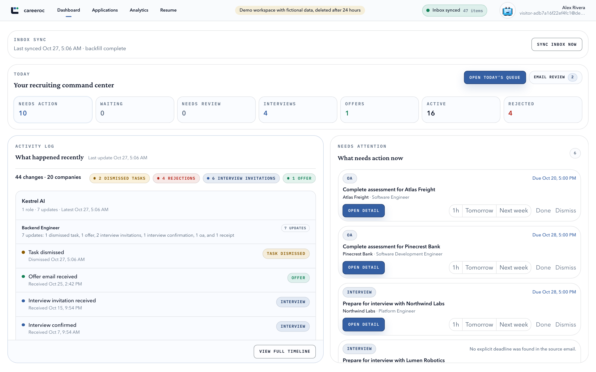
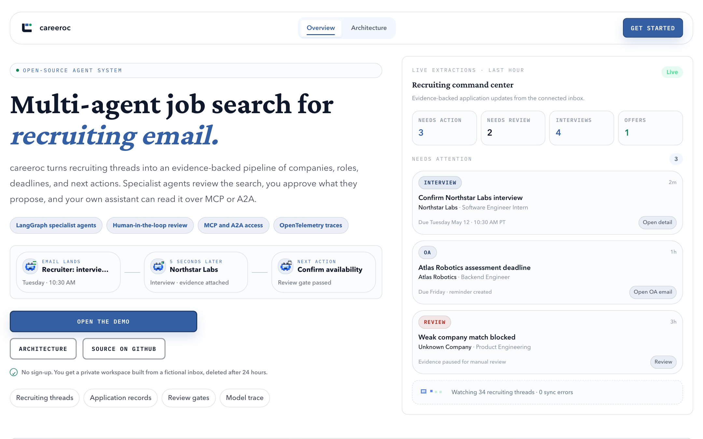
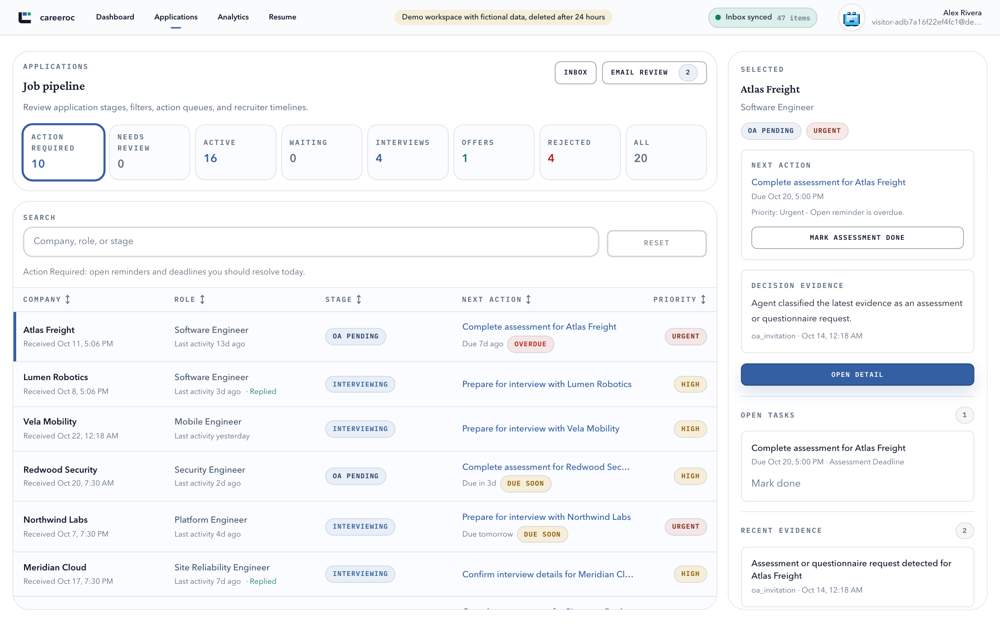
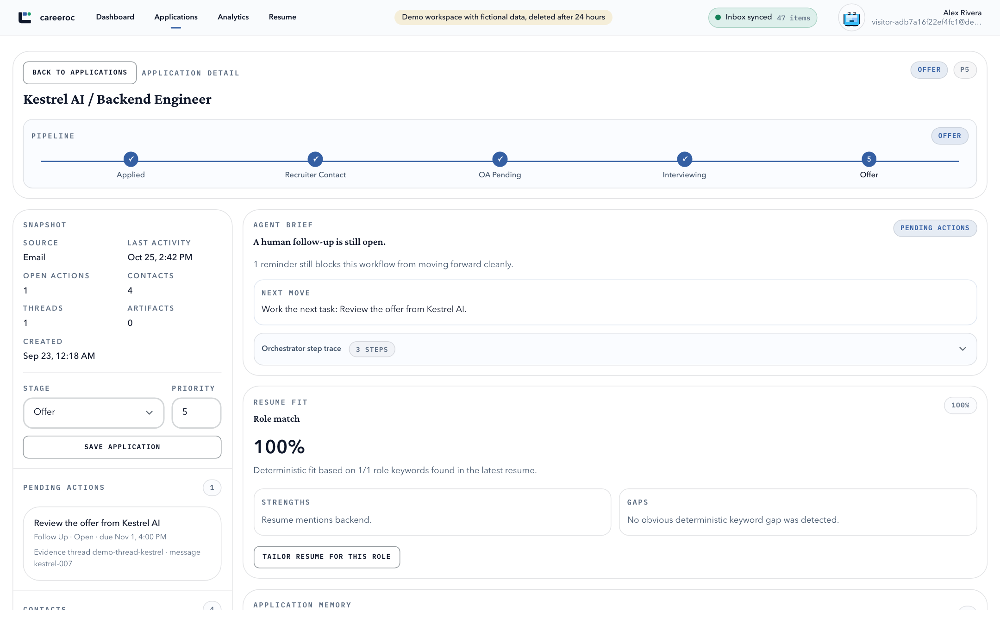
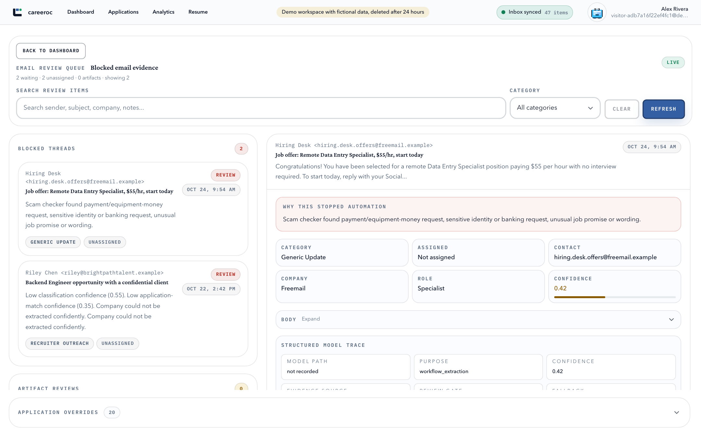
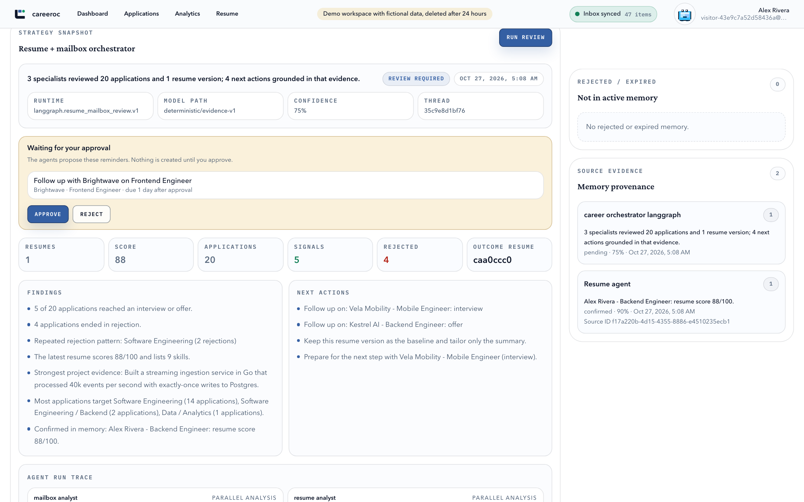
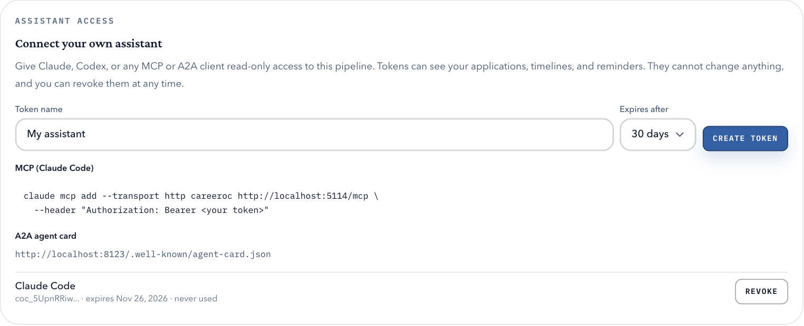
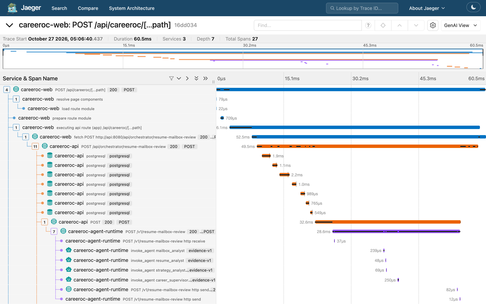
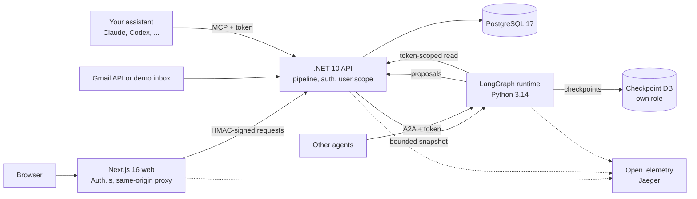

# careeroc

An open-source, multi-agent job search workspace.
careeroc reads recruiting email and keeps an evidence-backed pipeline of applications, deadlines, and next actions.
Specialist agents review the search, a person approves what they propose, and your own assistant can read the pipeline over MCP or A2A.

Try it with one command, no accounts or API keys: `docker compose --profile full up -d`, then open http://localhost:3000.
**Open the demo** gives each visitor a private workspace built from a fictional inbox, run through the real pipeline, and deleted after 24 hours.



This repository is the complete source of careeroc, a hosted product that is now published as a reference implementation.
It is a working system rather than a template: a .NET 10 API, a Next.js 16 web app, and a Python LangGraph runtime, with tests, evals, traces, and deployment code for Compose, Railway, AWS, and Kubernetes.

## What it shows

| Area | What is in the code |
|---|---|
| Email to pipeline | Deterministic-first extraction in .NET: triage, company, role, stage, deadlines, thread continuity, and reminders. An optional model pass is used only when it is available and confident; otherwise the deterministic result stands. |
| Review gates | Uncertain or risky evidence (agencies, scams, weak company matches) pauses in a review queue instead of changing the pipeline. |
| Multi-agent review | A LangGraph graph runs resume, mailbox, and strategy specialists in parallel, a supervisor merges them and proposes follow-up reminders, and an evidence gate checks every citation and proposal against the user's own data. |
| Human in the loop | A review that proposes a write pauses on a LangGraph `interrupt()` with a Postgres checkpoint. When the user approves it, the API, never the agents, creates the reminders, and the graph resumes so the decision lands in its trace. |
| Bring your own assistant | Read-only personal access tokens, an MCP server at `/mcp`, and an A2A 1.0 agent with a public agent card. |
| Observability | OpenTelemetry from the browser-facing web app through the API into each agent node, using the GenAI `invoke_agent` span conventions. |
| Evals | A labeled 51-email demo inbox scored in CI for triage, category, company, status, and review precision and recall, and a model-free eval of the evidence gate against invented citations and prompt injection. |
| Deploy anywhere | Docker Compose, Railway infrastructure as code, AWS ECS Fargate with OpenTofu, a Helm chart for any Kubernetes, and multi-arch images on GHCR. |

## Screenshots

| | |
|---|---|
|  **Landing.** One click opens a demo workspace. |  **Applications.** 51 emails become 20 tracked applications. |
|  **Application detail.** Pipeline stage, evidence, the agent brief, and resume fit. |  **Review queue.** The agency and the scam email wait for a person. |
|  **Multi-agent review.** The agents propose a reminder; nothing is created until the user approves. |  **Assistant access.** Tokens, the MCP command, and the A2A card. |

One "Run review" click, traced across all three services in Jaeger:



## Architecture



- **The API owns every write.** Agents receive a bounded snapshot with no email bodies, OAuth tokens, or database credentials, and return typed results and proposals; the API applies a proposal only after the user approves it and the application is theirs.
- **Deterministic first.** The email pipeline is rule-based and tested; models enrich it and are never required.
  The agent runtime ships a deterministic suite, so the demo and CI need no model or API key.
- **Every agent output is visible.** Traces, confidence, and evidence references are shown in the app, and low-confidence results and proposed writes stay pending until a person decides.

[DESIGN.md](DESIGN.md) explains the decisions, the rejected alternatives, trust boundaries, and failure modes.

## Quick start

You need Docker.

```bash
git clone https://github.com/hskl18/public-careeroc.git
cd public-careeroc
docker compose --profile full up -d
```

Open http://localhost:3000 and choose **Open the demo**.
Compose downloads the prebuilt images for your CPU (amd64 or arm64), so nothing is compiled.
Running, the four containers use about 600 MB of memory and almost no CPU.
Their ports are published on 127.0.0.1 only.

To run your own changes, add `--build`.
Compiling all three services from source takes several minutes and uses every CPU core Docker is allowed; lower that limit in Docker Desktop under **Settings > Resources** if your machine slows down.

To see traces, start Jaeger as well and open http://localhost:16686:

```bash
OTEL_EXPORTER_OTLP_ENDPOINT=http://jaeger:4318 \
  docker compose --profile full --profile observability up -d
```

### Connect your own assistant

In the app, open **Settings**, create a token under **Assistant access**, and copy it.

MCP, for example in Claude Code:

```bash
claude mcp add --transport http careeroc http://localhost:5114/mcp \
  --header "Authorization: Bearer coc_..."
```

The server exposes three read-only tools: `get_pipeline_summary`, `list_applications`, and `get_application`.

A2A: the agent card is at http://localhost:8123/.well-known/agent-card.json, with two skills, `pipeline_status` and `career_review`.

```bash
curl -s http://localhost:8123/a2a \
  -H "Authorization: Bearer coc_..." -H "A2A-Version: 1.0" -H "content-type: application/json" \
  -d '{"jsonrpc":"2.0","id":1,"method":"SendMessage","params":{"message":{"messageId":"m1","role":"ROLE_USER","parts":[{"text":"Review my search and suggest next steps."}]}}}'
```

Tokens are read-only, expire after 1 to 365 days, are stored only as SHA-256 hashes, and can be revoked at any time.

### Use a real model or your own Gmail

- **Model.** Set `AGENT_PROVIDER=ollama` (or `openai`) before `docker compose up`, with the model's base URL, name, and key in `Ollama__BaseUrl`, `Ollama__Model`, and `Ollama__ApiKey`; Compose passes those to the agent runtime for either provider.
  The deterministic suite stays the fallback.
- **Gmail.** Create a Google OAuth client, copy `.env.example` to `.env`, set `AUTH_GOOGLE_ID`, `AUTH_GOOGLE_SECRET`, and an access allowlist, and run the services outside demo mode as described in [AGENTS.md](AGENTS.md).
  Before you do, replace the `local-compose-only-*` secrets: the API and web app refuse them once real accounts can sign in.

## Deploy

| Target | Shape | Guide |
|---|---|---|
| Docker Compose | One host, all services, optional Jaeger | [docker-compose.yml](docker-compose.yml) |
| Railway | Two Postgres services and the three app services from [.railway/railway.ts](.railway/railway.ts) | [docs/deploy](docs/deploy/README.md#railway) |
| AWS | ECS Fargate on ARM64, one load balancer, RDS, Secrets Manager, OpenTofu | [infra/aws](infra/aws/README.md) |
| Kubernetes | Helm chart for GKE, AKS, EKS, or self-managed clusters | [deploy/helm/careeroc](deploy/helm/careeroc/README.md) |
| Vercel | The web app only, with the API and agents hosted elsewhere | [docs/deploy](docs/deploy/README.md#vercel-web-only) |

Images for all three services are published to GHCR for `linux/amd64` and `linux/arm64` on version tags, after every CI check passes.

## Repository layout

```text
apps/api                          .NET 10 minimal API host: endpoints, auth, MCP, demo, background workers
apps/web                          Next.js 16 app: public site, workspace, same-origin API proxy
src/Careeroc.Domain               entities and enums
src/Careeroc.Application          pipeline, agents, orchestrator, and query services
src/Careeroc.Infrastructure       EF Core, Gmail, parsers, demo inbox, migrations
src/Careeroc.Contracts            API DTOs shared with the web app
services/agent-runtime            LangGraph graph, evidence gate and its eval, A2A server, OpenTelemetry
tests/Careeroc.Tests              .NET unit, API, eval, and Postgres tests
eval                              labeled demo inbox and the latest eval results
infra/aws, deploy/helm, .railway  deployment code
docs                              design notes, ADRs, agent specs, and deploy guides
```

## Testing

```bash
dotnet test Careeroc.sln                       # .NET: pipeline, API, MCP, tokens, evals
pnpm --dir apps/web lint && pnpm --dir apps/web test:unit && pnpm web:build
cd services/agent-runtime && uv run ruff check . && uv run pytest
```

Set `CAREEROC_TEST_POSTGRES` to a Postgres connection string to also run the tests that need real Postgres behavior.

Two CI jobs start the whole system and drive it like a visitor and their assistant would, with [scripts/smoke-demo.sh](scripts/smoke-demo.sh): demo sign-in, the processed pipeline, a multi-agent review and its approval, a personal access token, MCP, A2A, and revoking the token.
One runs it on Docker Compose; the other installs the Helm chart on a kind Kubernetes cluster ([scripts/smoke-kubernetes.sh](scripts/smoke-kubernetes.sh)).
A third drives the review in Chromium against the real API with a scripted agent runtime ([scripts/e2e-multi-agent.sh](scripts/e2e-multi-agent.sh)).
CI also validates the OpenTofu and Helm code; the AWS stack is checked statically, not applied.

The pipeline eval in [eval/pipeline-results.json](eval/pipeline-results.json) is 1.0 on every metric.
The labeled set was written while fixing the defects it found, so treat it as a regression guard rather than a benchmark.
The evidence-gate eval and its cases are in [DESIGN.md](DESIGN.md#evals).

## Documentation

- [DESIGN.md](DESIGN.md) - system design, decisions, and trade-offs
- [docs/architecture.md](docs/architecture.md) - layers and processing flows
- API reference - the OpenAPI document at `/swagger` when the API runs in Development; [apps/web/src/lib/api-schema.ts](apps/web/src/lib/api-schema.ts) is generated from it and checked for drift in CI
- [UI.md](UI.md) - product surfaces and the UI contract
- [docs/routing.md](docs/routing.md) - web routes and API endpoints
- [docs/agents](docs/agents/README.md) - one spec per agent
- [docs/backend/agentic-workflow-engine-decision.md](docs/backend/agentic-workflow-engine-decision.md) - why LangGraph, and how the graph is shaped
- [docs/adr](docs/adr) - architecture decision records
- [SECURITY.md](SECURITY.md) - controls and how to report a vulnerability
- [AGENTS.md](AGENTS.md) - commands and conventions for contributors and coding agents

## License

[MIT](LICENSE)
